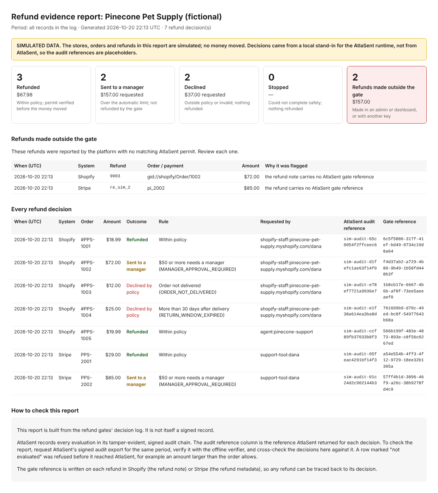

# @atlasent/refund-evidence — evidence report and three-system demo

This package does two things for the refund gate demos:

- **The evidence report** a finance reader opens: every refund decision in a
  period, the rule that decided it, and every refund made around the gate. It
  is a self-contained HTML page plus a CSV.
- **A one-command demo**, `npm run demo`. It runs one refund policy across the
  Shopify gate, the support agent's refund tool and the Stripe gate, refunds
  two orders around the gate, and produces the report.

`private: true`. This package is a demo and is not published to npm.



## Run the demo

```sh
cd typescript/packages/refund-evidence && npm ci
npm run demo                                             # simulated stores + local policy stand-in
ATLASENT_API_KEY=... ATLASENT_ENVIRONMENT=test npm run demo   # simulated stores, real AtlaSent decisions
```

The demo writes `evidence-out/report.html`, `report.csv` and
`decisions.jsonl`, and prints each decision as it happens:

| Path | Request | Outcome |
|---|---|---|
| Shopify admin button | #PPS-1001 $18.99, delivered 5 days ago | Refunded |
| Shopify admin button | #PPS-1002 $72.00 | Sent to a manager |
| Shopify admin button | #PPS-1003 $12.00, in transit | Declined: not delivered |
| Shopify admin button | #PPS-1004 $25.00, 45 days after delivery | Declined: window expired |
| Agent's refund tool | #PPS-1005 $19.99, the signed-in customer's order | Refunded |
| Agent's refund tool | #PPS-1005, asked for by a different customer | Refused before the gate |
| Stripe gate | PPS-2001 $29.00 | Refunded |
| Stripe gate | PPS-2002 $85.00 | Sent to a manager |
| Around the gate | #PPS-1002 $72.00 in the Shopify admin | **Flagged** |
| Around the gate | pi_2002 $85.00 in the Stripe Dashboard | **Flagged** |

The demo uses the real Shopify and Stripe gate code (imported from the
sibling packages), but **the stores are always simulated** and no money
moves. Without an API key, decisions come from a local stand-in that applies
the same policy. The report says both things in a banner on its face, and
its audit references are placeholders.

The agent path calls the agent's `issue_refund` tool directly, which is the
same code the Claude support agent runs. The model itself is not called. To
talk to the real agent, use `npm run agent` in `@atlasent/shopify`.

## Use the report with real gates

Both gates take an `onDecision` callback. It is called once per decision,
whether or not a refund ran, with an `atlasent.refund_decision.v1` record. If
the callback fails, the result carries `logWarning`; the outcome never
changes.

```ts
import { JsonlEvidenceLog } from "@atlasent/refund-evidence";
const log = new JsonlEvidenceLog("decisions.jsonl");
await guardedShopifyRefund(shopify, atlasent, request, { ...options, onDecision: (r) => log.append(r) });
```

Append alarm verdicts as `atlasent.refund_alarm.v1` records (see
`src/demo.ts`). Then build the report for a period:

```sh
npm run report -- --log decisions.jsonl --store "Pinecone Pet Supply" --from 2026-10-01 --to 2026-11-01
```

Lines that are not a known record are listed in the report, never silently
dropped.

## What the report is, and is not

- It **is** built from the gates' decision log, with every value
  HTML-escaped. In the CSV, a cell starting with `=` `+` `-` `@` gets a
  leading `'` so a spreadsheet does not run it as a formula.
- It is **not** itself signed. The proof is AtlaSent's signed audit export for
  the same period, verified with the offline verifier. The report says this
  in its "How to check this report" section, and lists AtlaSent's audit
  reference beside every decision that reached AtlaSent.
- Totals are kept per currency and never added across currencies.

## Tests

```sh
npm ci && npm run typecheck && npm test
```

The 17 tests cover:

- the summary, the period filter and per-currency totals;
- the simulated banner, present only when it applies;
- HTML escaping of hostile values, the CSV formula guard and quoting;
- log parsing, with rejected lines reported;
- the whole demo end to end, including that no permit token reaches the log
  or the report.

The suite was checked against seven specific defects, and each one made it
fail:

- dropping `<` escaping;
- dropping the formula guard;
- merging currencies;
- an inclusive period end;
- dropping bad log lines silently;
- counting ignored alarm verdicts as outside the gate;
- the agent reading orders without their email.
